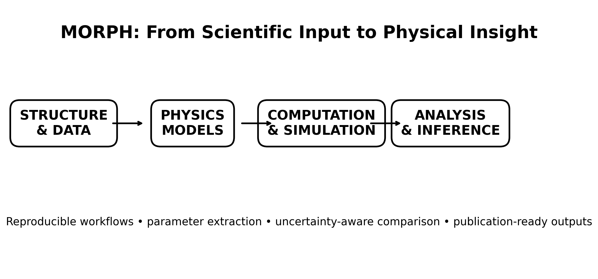
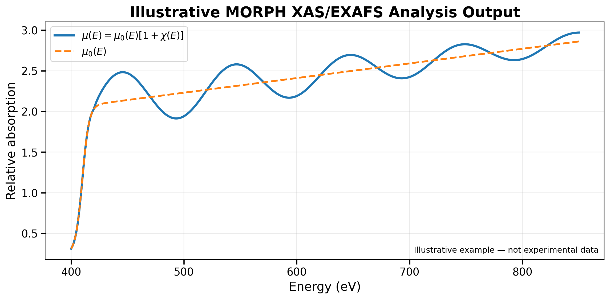

# MORPH

## Materials-Oriented Robotic Physics Helper

**MORPH** is a scientific computing framework for converting physics models, simulation outputs, and experimental data into reproducible physical insight.

MORPH began as a materials-physics workflow assistant and is being developed as a broader platform for computational physics, materials characterization, spectroscopy, statistical analysis, visualization, and research documentation. The word **Robotic** refers to workflow automation: MORPH is intended to automate repetitive scientific operations while keeping the physics, assumptions, parameters, and provenance visible to the researcher.



## Scientific vision

Modern research often requires a chain of operations rather than a single calculation:

**scientific input → physical model → computation → data analysis → parameter extraction → validation → interpretation → documented output**

MORPH is designed to make that chain transparent and reproducible. It is not intended to replace scientific judgment. Its purpose is to make the computational workflow easier to inspect, repeat, extend, and teach.

## Initial scientific applications

The first MORPH workflows emphasize materials physics and X-ray spectroscopy, including:

- FEFF input preparation and output processing
- XAS, XANES, and EXAFS analysis
- XPS spectral analysis and region-of-interest fitting
- absorption/background functions such as μ(E), μ0(E), and χ(k)
- Fourier-transform analysis from k-space to R-space
- structural and bond-distance interpretation using calculated scattering paths
- multivariate analysis, including PCA
- scientific plotting and publication-ready figure generation
- provenance, directory organization, and reproducible research documentation

MORPH is intentionally extensible. Future modules can incorporate additional spectroscopy, electronic-structure calculations, detector physics, transport, magnetism, thermodynamics, quantum modeling, uncertainty analysis, and other computational-physics workflows.

## Example: XAS/EXAFS workflow

An illustrative MORPH analysis can connect the absorption coefficient and oscillatory fine structure through a relation of the form

\[
\mu(E)=\mu_0(E)\,[1+\chi(E)]
\]

subject to the normalization convention used by the simulation or experiment.



The figure above is an **illustrative example**, not experimental data. Production MORPH analyses must preserve the definitions and column metadata supplied by the underlying simulation or experimental format.

For EXAFS, MORPH can operate on χ(k), apply a selected k-weighting and window, and transform the signal into R-space. Quantitative bond distances should be obtained using physically defined scattering paths and phase corrections rather than assigning raw Fourier-transform peak positions directly to interatomic distances.

## Example project: TiO0.5N0.5

An early MORPH demonstration uses a 12-atom titanium oxynitride model and FEFF calculations for multiple absorption edges:

- O K-edge
- N K-edge
- Ti K-edge
- Ti L-edge

The workflow is designed to preserve the complete chain from the atomic model and FEFF input through `xmu.dat`, `chi.dat`, scattering-path information, plots, and structural interpretation.

## Repository organization

```text
MORPH/
├── README.md
├── LICENSE
├── CITATION.cff
├── CONTRIBUTING.md
├── docs/
│   ├── SCIENTIFIC_SCOPE.md
│   ├── WORKFLOW.md
│   └── images/
├── examples/
│   └── TiON_FEFF/
│       └── README.md
├── src/
└── data/
```

As the software matures, `src/` will contain reusable analysis modules, while `examples/` will preserve complete, documented scientific demonstrations. Large raw datasets should normally be archived in a suitable research repository and referenced from GitHub rather than committed directly.

## Design principles

1. **Physics first.** Every numerical operation should have a stated physical or statistical meaning.
2. **Reproducibility.** Inputs, parameters, transformations, software versions, and outputs should be traceable.
3. **Modularity.** Spectroscopy, simulation, statistics, and visualization should be separable but interoperable.
4. **Validation.** Calculated results should be checked against known limits, reference calculations, experimental observations, or held-out data where appropriate.
5. **Human oversight.** Automated processing must not obscure assumptions or substitute algorithmic output for physical interpretation.
6. **Education.** Workflows should be understandable enough to support students learning the underlying physics.

## Current status

MORPH is an evolving research framework. The repository should initially be treated as a documented scientific-development project rather than a finished general-purpose software package. Interfaces, modules, and file structures may change as workflows are validated and consolidated.

## Documentation

Start with:

- [`docs/SCIENTIFIC_SCOPE.md`](docs/SCIENTIFIC_SCOPE.md) — scientific scope and architecture
- [`docs/WORKFLOW.md`](docs/WORKFLOW.md) — recommended reproducible workflow
- [`examples/TiON_FEFF/README.md`](examples/TiON_FEFF/README.md) — example FEFF/XAS project structure

## Citation

If MORPH contributes materially to published research, cite the software/repository version used. A `CITATION.cff` template is included and should be updated with the final GitHub repository URL and DOI if a DOI is issued.

## License

A license should be selected before public software reuse is encouraged. The included `LICENSE` file currently records this as **license pending** rather than imposing an unintended license.
